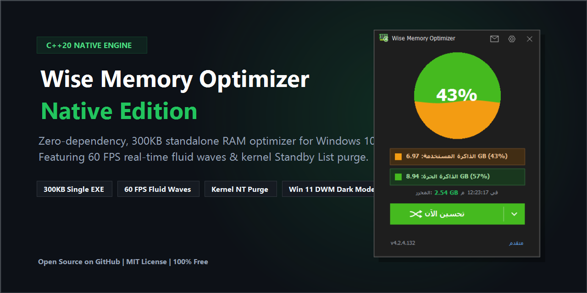
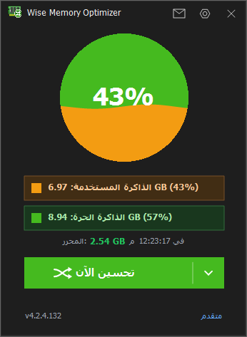
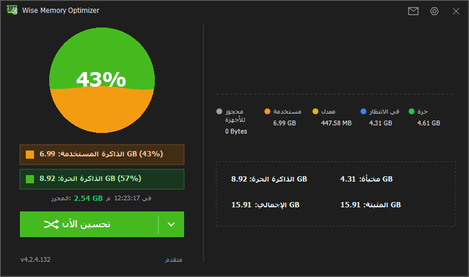
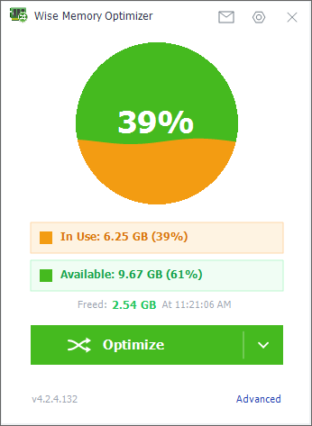
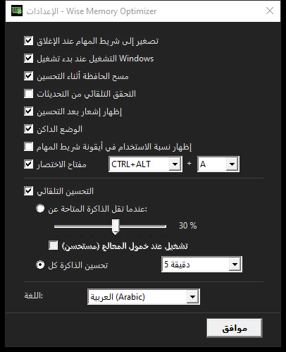

<p align="center">
  
</p>

# Wise Memory Optimizer Native (C++20 AAA 60FPS Edition)

<p align="center">
  <a href="https://github.com/sarasen33pl-bit/WiseMemoryOptimizer_Native/releases/download/v1.0.0/WiseMemoryOptimizer_Native.exe">
    
  </a>
  <a href="https://github.com/sarasen33pl-bit/WiseMemoryOptimizer_Native/releases/latest">
    
  </a>
  <a href="https://sarasen33pl-bit.github.io/WiseMemoryOptimizer_Native/">
    
  </a>
</p>

<p align="center">
  
  
  
  
  
  
</p>

A high-fidelity, ultra-optimized native C++20 clone of **Wise Memory Optimizer**. Built from the ground up with 100% native Win32 and GDI+, featuring zero external runtime dependencies, 60 FPS liquid wave graphics, immersive DWM dark mode, authentic dual-language support (English & Arabic), and kernel NT memory optimization APIs.

---

## 📸 Visual Previews

| Dark Mode (Collapsed) | Dark Mode (Expanded Metrics) |
|:---:|:---:|
|  |  |

| Light Mode (Live Live Waves) | Settings & Immersive Dark Dialog |
|:---:|:---:|
|  |  |

---

## ⚡ Performance Comparison (Native C++20 vs Modern Tools)

| Feature | Wise Memory Optimizer Native | Bloated Electron Utilities | Other Standard Tools |
|---|---|---|---|
| **Binary Size** | **~298 KB (Single EXE)** | 100 MB – 180 MB | 10 MB – 30 MB |
| **Runtime Overhead** | **< 8 MB RAM, 0% CPU Idle** | > 150 MB RAM, Chromium Engine | 25 MB – 50 MB (.NET / Java) |
| **Dependencies** | **Zero (100% Native Win32/C++20)** | Node.js, V8, Chromium DLLs | .NET Runtime, VC++ Redistributables |
| **Standby List Purge** | **Kernel NT `NtSetSystemInformation`** | ❌ No | ⚠️ Rare / Incomplete |
| **Wave Animation** | **60 FPS FoxProgressEx Fluid Engine** | HTML5 Canvas / CSS Lag | Static Progress Bar |
| **Dark Mode** | **Windows 10/11 DWM Immersive** | Inconsistent Web Themes | White System Borders |

---

## 🌟 Key Features

### 1. 🌊 Fluid Liquid Wave Engine (FoxProgressEx)
- 60 FPS mathematical sine/cosine fluid wave rendering in real-time.
- Smooth acceleration and rotational vector shuffle animations during active optimization.
- Accurate dynamic memory percentage counter with sub-pixel typography.

### 2. 🌙 Full Immersive Dark & Light Themes
- True Windows 10/11 DWM immersive dark mode titlebars across all windows (`DWMWA_USE_IMMERSIVE_DARK_MODE`).
- High-contrast, accessibility-compliant dark palettes (`RGB(30, 30, 30)` card backgrounds, `RGB(55, 65, 81)` subtle dividing pens, `RGB(65, 65, 65)` crisp dialog dividers).
- Instant live theme switching with immediate child control invalidation.

### 3. 🌐 Native Dual-Language Support (EN & AR)
- Complete, authentic Arabic translation with correct grammar and morning/evening suffixes (`ص` / `م`).
- Dynamic timestamp synchronization (`FormatTimestamp`) updating instantly on language change.
- Native RTL text rendering without external libraries.

### 4. ⚡ Kernel NT Memory Optimization Engine
- **Working Set Trimming:** Safely trims process working sets (`EmptyWorkingSet` via `OpenProcess`).
- **Standby List Purge:** Invokes undocumented NT kernel API `NtSetSystemInformation` (`SystemMemoryListInformation: 80`) with `MemoryPurgeStandbyList`.
- **System Working Set Flush:** Flushes modified and low-priority cache lists.
- **Privilege Elevation:** Automatically adjusts token privileges (`SeProfileSingleProcessPrivilege`, `SeIncreaseQuotaPrivilege`, `SeDebugPrivilege`).
- **Clipboard Management:** Safely empties temporary clipboard data during optimization if enabled.

### 5. 📊 Horizontal Accordion Detailed Metrics Panel
- Smooth horizontal sliding animation expanding from 346px to 800px.
- Real-time hardware breakdown:
  - Hardware Reserved
  - In Use (Active)
  - Modified
  - Standby (Cached)
  - Free Physical Memory
  - System Cache
  - Total Physical & Installed RAM

### 6. ⏱️ Intelligent Auto-Optimization & Timers
- **Interval Mode:** Automatically runs every 5, 10, 15, 30, 45, 60, or 120 minutes.
- **Threshold Mode:** Triggers when free memory drops below a custom percentage (5%–50%) with optional CPU idle check (< 15%).
- **Smart Timer Reset:** Manual optimization clicks instantly reset auto-optimization cooldowns to prevent collision.

### 7. 🔔 Non-Intrusive Toast Notifications
- Slide-in bottom-right toast notifications displaying freed RAM amount.
- Interactive mouse tracking: pauses auto-dismiss while the mouse is hovering.
- Quick "Do not show again" preference toggle.

### 8. 🎛️ System Tray & Global Hotkeys
- Dynamic system tray icon with real-time numeric memory percentage badge.
- Comprehensive tray context menu with quick interval presets.
- Customizable global hotkey (e.g., `Ctrl+Alt+A`).

---

## 📁 Project Architecture

```
WiseMemoryOptimizer_Native/
├── assets/                     # Application icons and logos
│   ├── app.ico                 # Multi-resolution icon
│   ├── ram_icon.png            # Main window chip graphic
│   └── about_logo.png          # Authentic About dialog banner
├── AboutDialog.h / .cpp        # About Dialog with credits & hyperlinks
├── Config.h                    # INI configuration loader/saver
├── FeedbackDialog.h / .cpp     # Feedback Dialog with interactive star rating
├── Localization.h              # English & Arabic string table
├── MainWindow.h / .cpp         # Main UI, FoxProgressEx fluid engine, tray, hotkey
├── MemoryEngine.h / .cpp       # Kernel NT API memory optimizer & CPU profiler
├── NoticeWindow.h / .cpp       # Smooth slide-in toast notification window
├── SettingsDialog.h / .cpp     # Preferences dialog (Auto-opt, hotkeys, theme, lang)
├── resource.rc                 # Win32 resource script & manifest
├── build.bat                   # MSVC automated compiler script
├── LICENSE                     # MIT License
└── README.md                   # Project documentation
```

---

## 🛠️ Build & Compilation

### Prerequisites
- Windows 10 or 11 (x64)
- Microsoft Visual Studio 2022 (Community, Professional, or Build Tools) with the **C++ Desktop Development** workload.

### Build Steps
1. Clone or extract the repository:
   ```cmd
   git clone https://github.com/<username>/WiseMemoryOptimizer_Native.git
   cd WiseMemoryOptimizer_Native
   ```
2. Run the automated build script:
   ```cmd
   build.bat
   ```
3. The compiled binary `WiseMemoryOptimizer_Native.exe` (~300 KB, zero external DLL dependencies) will be generated and copied to the root directory.

---

## 📄 License
This project is licensed under the [MIT License](LICENSE).
Wise Memory Optimizer is a trademark of WiseCleaner.com. This implementation is an independent native re-engineering for educational and optimization purposes.
